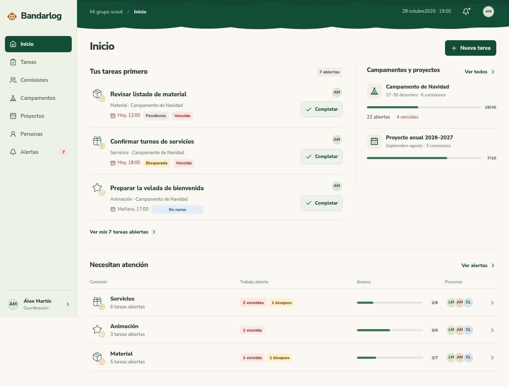

# Forest Experience · propuesta desktop

**Enmienda posterior del usuario:** se conservan los iconos anteriores. La copa con hojas reconocibles, profundidad y respuesta al ratón se revisa en [la enmienda botánica](refinement-leaves/README.md), con [captura actual](refinement-leaves/captures/comms-1440.png) y [demostración de movimiento](refinement-leaves/canopy-motion.gif). Veredicto independiente acotado: meets direction; aprobación visual pendiente. Las imágenes siguientes conservan la propuesta original del cuerpo de las pantallas.

Propuesta Codex con 78 escenas de diseño. Extiende la identidad móvil aprobada al escritorio: navegación lateral, copa compacta, verde y crema, Nunito, iconos del catálogo y recursos exclusivamente 2D. Veredicto independiente: **meets direction**, sin pendientes materiales. La aprobación visual del usuario está pendiente. La aplicación no se ha cambiado.

[Comisiones](published/comisiones-desktop.png) · [Comisión y panel de Responsable](published/responsable-desktop.png) · [Perfil y avisos](published/perfil-desktop.png) · [Todo al día](published/todo-al-dia-desktop.png) · [Liana en movimiento, simulación](published/liana-2d.gif).

## Recorrido y jerarquía

Inicio prioriza las tareas propias, después el trabajo autorizado del equipo y el contexto del campamento. Coordinación mantiene la atención global y los resúmenes de proyectos; Responsable gestiona dentro de su comisión; Scouter consulta y actúa sobre sus encargos. No se usan datos ocultos para completar la composición.

Desde los listados se accede al detalle lateral y a las acciones permitidas. Las comisiones se agrupan por proyecto y campamento. El panel de Responsable se compacta para dejar sitio al trabajo. Proyecto anual y campamento mantienen sus pestañas; las invitaciones desde cada contexto tienen destino fijo.

El tablero incluye acceso, primer acceso, foto/recorte, perfil y preferencias reales, formularios, errores, cancelaciones, carga, sin resultados, sin datos, bloqueos, tareas terminadas y todo al día. Se conservan los nombres normales de las comisiones bajo Campamento de Navidad y sus iconos asociados.

## Movimiento

La enmienda del usuario exige que el mono 2D cruce de lado a lado en cada finalización guardada, con «Tarea completada» y Deshacer. La variante de menor movimiento conserva el cruce y retira balanceos accesorios. El GIF es una simulación de 31 fotogramas: muestra el trayecto, pero no demuestra que un evento de la aplicación lo active. La repetición del GIF facilita verlo y no prescribe un bucle decorativo en la aplicación.

## Evidencia y límites

La versión final se capturó en 176 casos geométricos: todas las 78 escenas a 1440×900 y 1280×800, más diez escenas clave a 1024×768 y 1920×1080. Hay 216 imágenes originales al contar también las capturas de viewport de esos casos clave. Las mediciones no registran errores de página, desbordamiento horizontal ni imágenes rotas. Las capturas no certifican accesibilidad ni verifican permisos, API, guardado, correo o foco funcional.

Las matrices independientes y los recursos de origen están en `qa/`, `codex/` y las fuentes preservadas de las rondas. Los originales PNG completos se conservan localmente y son reproducibles con `capture-desktop.mjs`; `published/` ofrece exportaciones WebP de las mismas dimensiones, cinco originales PNG para revisión y la simulación animada. El manifiesto identifica dimensiones y hashes.

Se usaron guías oficiales W3C/WAI; no benchmarks de productos externos ni Stitch. Las decisiones de composición son juicio de producto dentro de la identidad aprobada. No hay cambios de aplicación, dependencias, variables externas ni despliegue. La integración propuesta está en [handoff-propuesto.md](handoff-propuesto.md).
