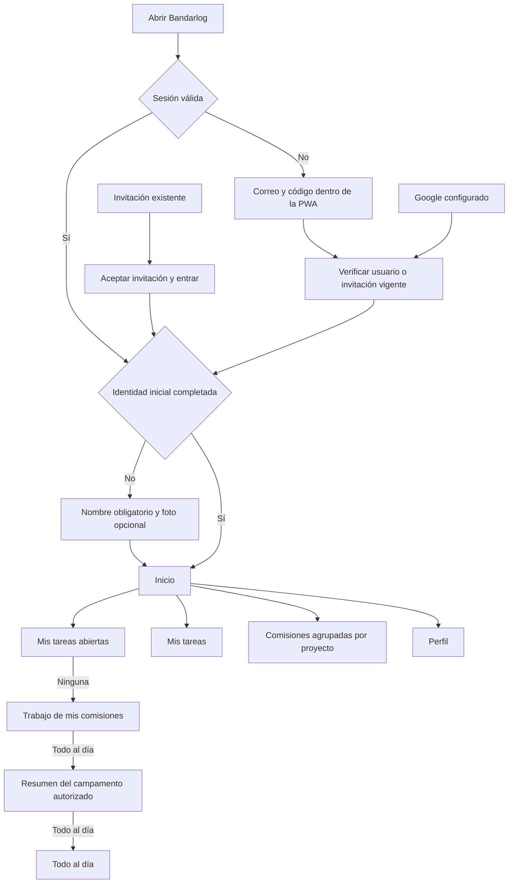

# Bandarlog · Forest Experience

Propuesta de diseño, no implementación. Rama `feat/forest-experience`, basada en `main` tras el PR #8 (`6f91e25`). No cambia la aplicación, la base de datos ni Railway. Fecha de revisión: 28 de octubre de 2026.

## Decisiones confirmadas

- Objetivo confirmado por la persona solicitante: rehacer toda la experiencia móvil, conservando producto, permisos, datos, desktop y Smart Focus.
- Evidencia: **solo guías oficiales**, elección explícita de esta revisión. No se inspeccionó Mobbin ni se atribuyen patrones a otras aplicaciones.
- Aprobaciones: **seguir recomendación**, elección explícita. El objetivo está confirmado; la dirección recomendada se selecciona automáticamente. La propuesta visual necesita aprobación antes de implementar.
- Integraciones disponibles y leídas: Design Arc, Designly Director y sus especialistas, Impeccable. La carga automática del motor local de Impeccable falló por permisos de escritura de su caché; se consultaron directamente las instrucciones y el contexto del repositorio. No se atribuyen resultados a un motor que no se ejecutó.
- Las elecciones son de esta revisión; no se han creado preferencias globales, un nuevo proyecto ni un acceso lateral de Design Arc.

## Auditoría del estado actual

Se inspeccionaron componentes, API, esquema, configuración PWA, catálogo, pruebas y capturas del PR #8. Las capturas muestran datos aislados; no representan personas ni trabajo real del grupo.

| Hallazgo | Evidencia | Consecuencia y decisión |
| --- | --- | --- |
| Saludo, subtítulo y dos accesos al mismo listado | `src/MobileUX.tsx`, captura Inicio 390 | Sustituir por título útil, resumen breve y un único acceso al resto. |
| Tareas en tarjetas independientes y métricas con peso similar | Inicio actual, `src/styles.css` | Lista continua con divisores; pendientes manda y las incidencias son secundarias. |
| Fragmento bajo el mono de Cocina | `src/Artwork.tsx`, captura comisión 390 | El viewport SVG cuadrado se presenta en una caja vertical; separar personajes en archivos reales, sin depender de coordenadas de un sprite. Revisar bordes de las fuentes. |
| Progreso y explicaciones repetidos | Detalle de comisión | Un progreso, acciones por permiso y resumen responsable compacto. |
| Etiquetas de navegación pequeñas y blur | CSS de navegación móvil | Etiquetas de 12 px, base opaca, cuatro destinos estables. |
| Solo acceso por enlace de correo | `server/index.ts:159` | Añadir código dentro de la PWA y mantener enlaces anteriores. |
| Sesión fija de siete días sin renovación | `server/index.ts:232`, middleware de sesión | Sesión local con inactividad y límite absoluto; propuesta detallada en autenticación. |
| No hay marca de onboarding | `server/schema.ts` | Marca persistida en servidor para nuevos usuarios; migrar existentes como configurados. |
| `bootup` no diferencia red de sesión cerrada | `src/main.tsx:206` | Preservar contexto seguro, mostrar reintento para red y acceso para 401. |
| Foto ya resuelta con recorte y compresión | `src/PhotoEditor.tsx`, `server/photos.ts` | Reutilizar, con cámara opcional cuando el dispositivo la admita. |
| Smart Focus y completar/Deshacer ya funcionan | `src/focus.ts`, `src/AnimatedCounter.tsx`, pruebas API/browser | Conservar la lógica y verificar regresiones durante implementación. |

## Dirección recomendada y alternativa

**A · Copa compacta, seleccionada por el modo Seguir recomendación.** Cabecera en flujo normal: contenido de 64 px, borde orgánico de 16 px y área segura superior. Marca oficial integrada, palabra en crema y avatar al otro extremo. El contenido comienza inmediatamente con el trabajo. La navegación inferior mantiene Perfil cuando la copa sale del viewport al hacer scroll. No se introduce una segunda cabecera flotante.

La secuencia es acceso → identidad inicial si corresponde → foco personal → consulta de equipo → campamento autorizado → todo al día. Se mantienen las pantallas existentes y se añaden código, identidad inicial y recuperación explícita de sesión. Beneficio: menos ruido y comportamiento estable con 1, 5 o 10 comisiones. Riesgo: comprobar que la silueta no invade texto o notch en tamaños pequeños. La cabecera no se anima; contadores y confirmaciones conservan el movimiento existente.

**B · Copa expansiva con contracción al hacer scroll.** Mismo recorrido, permisos y contenido, con una cabecera inicial más alta y reducción posterior. Refuerza la identidad en el primer viewport, pero reduce densidad y exige gestionar desplazamiento, foco y movimiento reducido sin saltos. Es complejidad adicional en React/CSS sin ventaja para completar tareas. No seleccionada. Una transición de contracción no tiene duración validada: `unverified`; requeriría medición en staging y dispositivos. Con movimiento reducido debería permanecer compacta.

Ambas direcciones se contrastan con W3C sobre reflow/foco/animación y WebKit sobre áreas seguras, no con benchmarks. Las dimensiones de la copa son criterio de diseño del producto, no requisitos de plataforma.

## Recorridos y permisos

Scouter completa únicamente tareas propias según los permisos actuales y consulta el equipo. Responsable gestiona tareas y personas de sus comisiones. Coordinación conserva sus herramientas globales autorizadas. Administración conserva sus herramientas adicionales. La apariencia es común; los controles dependen del servidor. Los agregados del campamento no revelan detalles ocultos ni amplían escritura. Los nuevos accesos resuelven al mismo usuario y reutilizan las autorizaciones existentes.

## Contrato visual

Modo Impeccable: **Operate**. El trabajo es el foco; la marca aporta identidad sin competir.

| Elemento | Contrato |
| --- | --- |
| Paleta | Bosque `#124D38`, profundo `#103B2D`, crema `#FAF8F2`, tinta `#24352B`, secundario `#52675A`, línea `#DFE5DA`. Arena para campamento; error `#A52D26`, aviso `#805006`. Sin nuevas familias decorativas. |
| Copa | SVG decorativo ligero, curva inferior orgánica de pocos lóbulos, sin foto, hojas interiores ni animación continua. Geometría proporcional al ancho. Interacciones en HTML y en flujo normal. |
| Marca | Reutilizar `brand-mark.webp` transparente. Wordmark Bandarlog en crema, Nunito Sans 800, sin cápsula blanca. No redibujar ni recolorear el mono. |
| Espaciado | 16 px de margen en 320/375; 20 px en 390/430. Ritmo 8/12/16/24/32. |
| Tipografía | Nunito Sans: pantalla 26/30, sección 18/24, tarea 16/22, cuerpo y campos 16/24, contexto 14/20, navegación 12/16. No reducir texto para forzar altura fija. |
| Tareas | Filas abiertas; objetivo de completar de 44×44, cuerpo de fila separado, título que envuelve, calendario o tienda más nombre de proyecto y comisión, fecha y estado textual. Solo tres destacadas en Inicio. |
| Resumen | Un número principal de pendientes, incidencias reales como secundarias. Ceros innecesarios ocultos tras finalizar transición. No cinco KPI decorativos antes de las tareas. |
| Comisiones | Grupos por proyecto y filas compactas. Icono 40–44 px, nombre, estado o avance. Ninguna tarjeta hero por cada comisión. |
| Detalle de comisión | Mascota secundaria 72–96 px, un avance, acciones por permiso y pestañas. Nombres largos envuelven. No superponer mono y acciones. |
| Navegación | Inicio, Mis tareas, Comisiones, Perfil. Base crema opaca, iconos 22–24 px, etiquetas 12 px, cuatro columnas. Selección con forma/peso y color. Altura 68 px más área segura inferior. |
| Formularios | Etiquetas visibles, campo de 48 px mínimo, una acción primaria, error junto a su campo. Diálogo nativo, foco contenido y retorno al activador. |
| Responsive | Copa y nuevo lenguaje operativo móvil por debajo de 768 px. Tablet y desktop conservan la composición existente. Login y onboarding nuevos necesitan versión amplia coherente. |
| Safe areas | `viewport-fit=cover`, padding con `env(safe-area-inset-*)`, contenido y acciones fuera del notch y del indicador inferior. No bloquear zoom. |

La propuesta visual separa escenas para revisarlas; las pantallas de la aplicación se implementarán después de su aprobación. Los controles de la lámina son muestras estáticas, sin autenticación ni acciones reales.

## Estados esenciales

| ID | Pantalla/estado | Contenido y recuperación |
| --- | --- | --- |
| F01 | Acceso | Correo → Recibir código. Google solo si está configurado. |
| F02 | Código | Campo único pegable, reenviar al cumplirse espera, cambiar correo. |
| F03 | Aceptar invitación | Aceptar invitación y entrar; mantiene compatibilidad con enlaces actuales. |
| F04 | Primer acceso | ¿Cómo te llamamos? Nombre obligatorio, foto opcional, Continuar. |
| F05 | Foto | Editor circular existente, arrastrar/zoom/centrar, cancelar sin perder nombre. |
| F06 | Inicio personal | 7 abiertas, hasta tres prioritarias, una ruta al resto. |
| F07 | Última tarea | 1→0, satisfacción 2–3 s, Deshacer y permanencia del mensaje personal. |
| F08 | Inicio equipo | Personal al día, hasta tres tareas de comisión en consulta. |
| F09 | Inicio campamento | Resumen autorizado sin detalles ajenos. |
| F10 | Todo al día | Una confirmación tranquila, ilustración pequeña e historial real opcional. |
| F11 | Mis tareas | Lista única por vencimiento, sin pestañas obligatorias Ronda/Campamento. |
| F12 | Detalle tarea | Contexto, fecha, estado, descripción, responsables, actividad y acciones autorizadas. |
| F13 | Mis comisiones | Diez comisiones agrupadas por proyecto. |
| F14 | Detalle comisión | Un avance; tareas, personas y actividad. Acciones según rol. |
| F15 | Proyectos | Proyectos anuales con contexto y avance. |
| F16 | Campamentos | Campamentos y + Nuevo campamento. |
| F17 | Seguimiento coordinación | Resumen y atención reales, progresivo y compacto. |
| F18 | Personas | Lista legible, invitación individual/lista, destino fijado por contexto. |
| F19 | Perfil | Nombre, foto y avisos; cerrar sesión revoca en servidor. |
| F20 | Formulario | Nueva tarea con validación, cancelación y datos preservados al fallar. |
| F21 | Sin asignaciones | Explicación breve sin cifras ni trabajo inventado. |
| F22 | Cargando | Banana existente, estado accesible; no destello de cuenta cerrada. |
| F23 | Sin conexión | Reintentar; no afirmar que una mutación no confirmada se ha guardado. |
| F24 | Sesión caducada | Acceso por código, conservar solo destino seguro, sin datos sensibles en URL. |
| F25 | Error de código | Mensaje local, código corregible; nuevo desafío al agotar intentos. |
| F26 | Foto omitida | Nombre válido, iniciales y acceso; no reiterar onboarding. |
| F27 | Google cancelado | Regreso al acceso, alternativa por código. No acceso creado. |

## Autenticación y persistencia propuestas

1. **Código:** seis dígitos, diez minutos, cinco intentos por desafío, reenvío tras 60 s que invalida el anterior. Son decisiones propuestas del producto. Identificador aleatorio y verificador HMAC con secreto servidor, no hash simple de seis dígitos; consumo atómico, límites persistentes por correo/desafío y límite por IP. Respuestas genéricas. Envío por la cola actual. No almacenar códigos o credenciales en `localStorage`, logs ni URLs.
2. **Invitación:** conservar el token vinculado a la invitación, su revocación y aceptación transaccional. Código o Google solo conceden las pertenencias de invitaciones vigentes; no existe registro abierto al grupo.
3. **Google opcional:** OIDC Authorization Code con `state`, `nonce`, PKCE, callback exacto y verificación backend de firma, `iss`, `aud`, `exp`, `nonce`. Identidad única `(provider, sub)`. Para asociar una cuenta existente con correo ajeno a Gmail/Workspace no basta `email_verified`: exigir código enviado a esa dirección. Una identidad vinculada no se reasocia silenciosamente por cambio de email. Scopes mínimos `openid email profile`.
4. **Configuración externa futura:** cliente OAuth web separado de Gmail; nuevas variables servidor `GOOGLE_LOGIN_CLIENT_ID`, `GOOGLE_LOGIN_CLIENT_SECRET`, `AUTH_CHALLENGE_SECRET`. Callback derivado de `APP_URL`: `/api/auth/google/callback`. No reutilizar `GMAIL_*`, no solicitar scopes Gmail ni refresh token Google para mantener sesión local. Sin configuración válida no mostrar el botón Google en la app. La lámina etiqueta expresamente el estado configurado.
5. **Sesión:** propuesta de 30 días de inactividad y 90 días absolutos. Guardar creación, límite absoluto y última renovación; renovar con actividad válida como máximo una vez al día y sin superar límite absoluto. Cookie `HttpOnly`, `Secure`, `SameSite=Lax`; identificador opaco guardado como hash, CSRF y verificación de origen. Rotar al autenticar/cambiar identidad/elevar privilegios; no en cada GET. Logout revoca sesión y cookie.
6. **Identidad inicial:** añadir `onboarding_completed_at`. En la migración, usuarios existentes quedan configurados; nuevos usuarios quedan pendientes. Endpoint con CSRF guarda nombre no vacío, foto opcional y fecha servidor atómicamente. Nombre de invitación prellenado y editable. «Ahora no» omite solo foto, nunca el nombre. Cancelar editor conserva el nombre. El avatar sigue normalizándose en cliente y servidor.
7. **PWA:** mantener API fuera de caché; distinguir error de red de 401. Un código dentro de la PWA evita depender de compartir cookies con el navegador externo. No dar por resuelto el retorno OAuth entre Safari/Chrome/PWA sin pruebas reales de dispositivo.

No se han configurado credenciales, Google ni sesiones reales. Es un handoff de diseño y seguridad para la implementación posterior.

## Movimiento

| ID | Propósito, trigger y estados | Contrato y evidencia | Movimiento reducido / interrupción | Prueba pendiente |
| --- | --- | --- | --- | --- |
| M01 | Completar/Deshacer; contador anterior→valor confirmado | React `AnimatedCounter`, 350 ms y ancho estable; comportamiento inspeccionado en fuente, `directly observed` en código, ejecución nueva `unverified`. Dirección visual descendente/ascendente sin rebote. | Mostrar valor final sin desplazamiento; nueva actualización reemplaza anterior por revisión. SR anuncia solo valor vigente. | Medir en aplicación implementada y comprobar concurrencia. |
| M02 | Última tarea propia; 1→0→consulta de equipo | Conservar pausa 2600 ms del código actual (`directly observed` en fuente). Mensaje propio permanece al pasar de nivel. | Mismo estado y pausa legible sin transición espacial; Deshacer cancela satisfacción. | Cronometrar en staging; preservar scroll y no auto-navegar. |
| M03 | Confirmar tarea; mono con liana y texto Tarea completada | Reutilizar recurso y lógica actual de 2500 ms (`directly observed` en fuente). No introducir nueva coreografía. | Texto/resultado y Deshacer permanecen; sin desplazamiento no esencial. Nueva tarea reinicia feedback sin bloquear controles. | Comprobar que no tapa acciones y que reduced-motion evita desplazamiento. |
| M04 | Carga de elemento | Banana con contorno verde, relleno amarillo y tres manchas; conservar componente actual. | Indicador estático y etiqueta de estado cuando se reduce movimiento. Sin progreso porcentual inventado. | Comprobar SR y solicitudes lentas en implementación. |
| M05 | Navegar, modal y cambio de nivel | Navegación nativa y actualización sin efecto espacial adicional. Cero animación en copa. `Design Arc judgment` para la ausencia deliberada de nuevos efectos. | Estados y foco equivalentes, sin desplazamiento. Cancelar devuelve foco. | Teclado, back, teclado virtual y safe areas en dispositivos. |

Destino de implementación: Web/React/CSS del repositorio. Las curvas exactas existentes se conservarán y se medirán en la implementación; no se atribuyen timings a W3C ni a otras apps. La lámina estática demuestra composición y estados, nunca duración, rendimiento ni tecnología asistiva real.

## Ilustraciones y manifiesto

Mantener los 338 IDs y asociaciones del catálogo, incluido Campamento de Navidad. Exportar cada personaje a WebP transparente independiente con margen suficiente. Compatibilizar las rutas históricas `#tile` al leer datos; no invalidar las parejas guardadas. La exportación matemática no garantiza un accesorio íntegro si ya estaba cortado en la fuente: detectar, documentar y reparar esas piezas de forma específica, sin cambiar las demás.

La propuesta reutiliza las imágenes oficiales individuales existentes. No genera ni sustituye los 338 monos. El manifiesto identifica recursos de diseño y su implementación futura. Ningún recurso de Stitch se mezcla sin aprobación explícita de un híbrido.

## Evidencia oficial consultada

Consulta web de lectura, 28-10-2026. Los extractos prueban el principio indicado, no la conformidad de una aplicación aún no implementada.

- [W3C: Target Size Enhanced](https://www.w3.org/WAI/WCAG22/Understanding/target-size-enhanced.html): objetivos de 44×44; aquí se adopta el objetivo reforzado como criterio del producto, sin confundirlo con el mínimo AA de 24 px.
- [W3C: Reflow](https://www.w3.org/WAI/WCAG22/Understanding/reflow.html): lectura a ancho equivalente de 320 CSS px sin desplazamiento horizontal de página.
- [W3C: Focus Not Obscured](https://www.w3.org/WAI/WCAG22/Understanding/focus-not-obscured-minimum.html): cabeceras/barras no deben ocultar el componente enfocado.
- [W3C: Animation from Interactions](https://www.w3.org/WAI/WCAG22/Understanding/animation-from-interactions.html): desactivar movimiento no esencial conservando funcionalidad.
- [WebKit: Designing Websites for iPhone X](https://webkit.org/blog/7929/designing-websites-for-iphone-x/): `viewport-fit` y `safe-area-inset-*`; validar además dispositivos actuales.
- [Google web.dev: Detection](https://web.dev/learn/pwa/detection): contextos navegador/standalone y diferencias de plataforma; detectar modo no transfiere sesiones.
- [Google: Verify ID tokens](https://developers.google.com/identity/gsi/web/guides/verify-google-id-token): validación backend y política de correo autoritativo.
- [Google: OpenID Connect](https://developers.google.com/identity/openid-connect/openid-connect): `sub`, `state`, `nonce`.
- [Google: OAuth web server](https://developers.google.com/identity/protocols/oauth2/web-server): secreto en backend y callback registrado.
- [WebKit: Updates to Storage Policy](https://webkit.org/blog/14403/updates-to-storage-policy/): persistencia y eliminación de almacenamiento; no garantiza compartir sesión con navegador externo.
- [Google web.dev: PWA architecture](https://web.dev/learn/pwa/architecture): decisiones de arquitectura PWA; no prueba por sí sola compatibilidad de Google instalado.

## Plan de implementación y aceptación posterior

1. Recursos individuales y componentes copa/listas/navegación, aislados del desktop; mantener lógica de tareas.
2. Migración compatible de onboarding, desafíos de código y sesiones, con pruebas API de autorización, consumo concurrente, revocación, expiración, intentos y CSRF.
3. Primer acceso con editor existente y Google opcional; pruebas con firma/audiencia/nonce/state erróneos y vinculación segura. Configuración externa documentada sin valores inventados.
4. Browser aislado: 1/5/10 comisiones y 74 tareas (7 propias abiertas, 30 de equipo, 14 de otras comisiones solo agregadas y 23 terminadas), completar/deshacer, contadores, pausa final y permisos por rol.
5. Capturas y revisión visual conjunta a 320/375/390/430, landscape, tablet y desktop; 200% zoom, foco, contraste, etiquetas y movimiento reducido. Revisar todas las parejas, especialmente Cocina y seis Navidad, en cajas 1:1, 3:4 y 4:3.
6. Dispositivo real: Safari iOS, Chrome iOS y Android, navegador/PWA, cámara, teclado, retorno OAuth y reapertura tras días. Esos resultados permanecen pendientes hasta probarse.

No se repite ahora la batería de 36 pruebas API/aplicación y 42 browser del PR #8: la propuesta no altera código ejecutable. Durante implementación se ejecutará esa cobertura y las nuevas pruebas pertinentes.

## Estado de aprobación

Objetivo confirmado. Dirección A seleccionada por el modo elegido. Propuestas iniciales renderizadas: [comparación](comparacion.md). Codex cumple con correcciones; Stitch no cumple. El alcance de refinamiento está pendiente de elección explícita; cero rondas aplicadas. La validación y sus límites se registran en `validacion.md`. **No implementar ni desplegar basándose únicamente en este documento.** La siguiente aprobación es sobre las pantallas renderizadas, no sobre una promesa de diseño.
