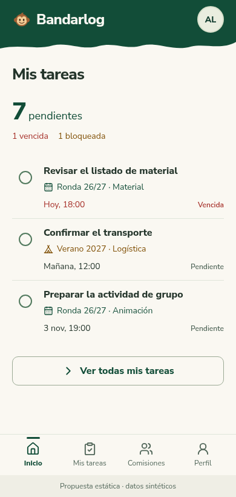
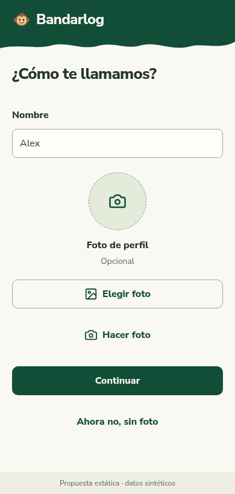
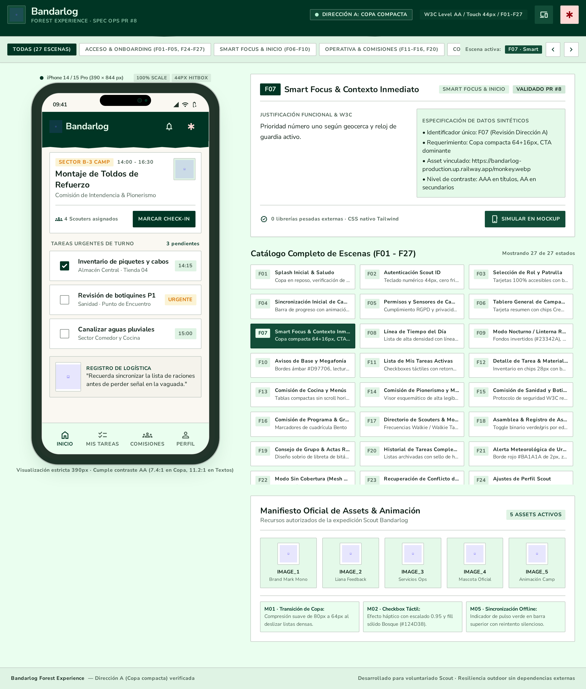
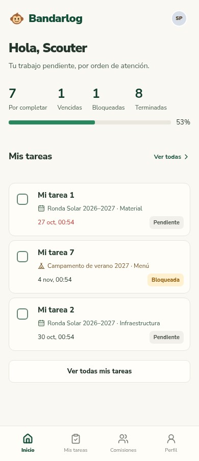

# Forest Experience · comparación inicial

**Actualización:** el usuario eligió refinar Codex. La [propuesta refinada](propuesta-refinada.md) ya está revisada con veredicto `meets direction`; se conserva esta comparación inicial como evidencia.

Dos propuestas generadas en paralelo desde la misma especificación, tras verificar la conexión oficial de Stitch. Son diseños estáticos; no se ha cambiado la aplicación. La persona solicitante considera la salida de Stitch «extremadamente básica». Esa valoración queda incorporada a la revisión y no se presenta como una propuesta aceptable.

## Resultado

| | Codex | Stitch |
| --- | --- | --- |
| Veredicto inicial | **meets with corrections** | **does not meet** |
| Pantallas | 27 estados principales y cuatro variantes, con HTML estático separado | Un tablero con un teléfono y un catálogo de 27 títulos; varios corresponden a funciones no solicitadas |
| Identidad | Marca y monos originales cargados; copa y paleta previstas | Marca y monos sin cargar; copa poco reconocible y superficies distintas |
| Recorrido | Código, invitación, nombre/foto, Smart Focus y estados de recuperación representados | Introduce PIN de patrulla, check-in, geocerca, asistencia y otras funciones ajenas; falta el primer acceso obligatorio |
| Densidad y navegación | Filas continuas y cuatro destinos; navegación pendiente de mantenerse visible al hacer scroll | Paneles y tarjetas de especificación; no aporta las pantallas completas pedidas |
| Responsive | 52 mediciones en 320/375/390/430/768/844/1440; cero overflow horizontal y cero imágenes fallidas | Solo captura del tablero de 2560×3006; variantes solicitadas sin prueba |
| Límite | No demuestra interacción, permisos, onboarding persistido, sesiones ni dispositivos físicos | Las afirmaciones del generador sobre cumplimiento, contraste y validación no son pruebas |

**Recomendación:** refinar Codex como base. Su recorrido respeta el producto y permite concentrar la siguiente ronda en calidad artística y detalles funcionales. No está listo para implementar: la copa necesita leerse como una copa de árbol, se deben recuperar los iconos asociados de las comisiones y corregir navegación, escenas incompletas y coherencia de los datos de ejemplo. Stitch exigiría reconstruir la mayor parte de su salida, conservando el resultado inicial como evidencia.

No se han aplicado correcciones después de las primeras capturas. La comparación utiliza el mismo contrato para ambos; ninguno sirve como autoridad visual del otro.

## Vistas para decidir

### Codex · Inicio y primer acceso

| Inicio propuesto | Primer acceso |
| --- | --- |
|  |  |

### Codex · todas las escenas

- [Tablero navegable estático](codex/index.html), sin autenticación ni acciones reales.
- [F01–F09: acceso, identidad y foco](codex/captures/board-1-9.png).
- [F10–F18: trabajo, comisiones y gestión](codex/captures/board-10-18.png).
- [F19–F27: perfil, estados y recuperación](codex/captures/board-19-27.png).
- [Diez comisiones, captura completa](codex/captures/f13-390.png).

Las miniaturas de la lámina recortan las escenas largas a su marco de revisión; las capturas individuales y los archivos de escena conservan el resto del contenido. Ese marco no demuestra navegación persistente durante scroll.

### Stitch · salida original

[Abrir captura original completa](stitch/original.png). Proyecto privado: [Bandarlog · Forest Experience](https://stitch.withgoogle.com/projects/9157822480698906524).

Los sellos «Validado», «AAA» y «44px» son texto generado por Stitch. La revisión no los avala. El export original se conserva para trazabilidad; su HTML incluye JavaScript y dependencias externas, no se ejecutó como aplicación ni se incorporó a Bandarlog.

## Antes y propuesta

| Inicio actual, PR #8 | Propuesta Codex |
| --- | --- |
|  |  |

Las capturas anteriores proceden del commit de `main` `6f91e25`. Todo el contenido de estas imágenes es de prueba.

## Revisiones y evidencia

- [Matriz independiente de Stitch, F01–F27](stitch/initial-review.md).
- [Matriz independiente de Codex, F01–F27](codex/initial-review.md), además de la [revisión de construcción](codex/INITIAL-QA.md).
- [Mediciones de Codex](codex/measurements.json) y [contraste](codex/contrast.json).
- [Manifiesto de recursos Codex](codex/assets-manifest.json), separado del [export Stitch](stitch/response.json).
- [Especificación exacta enviada](common-brief.sent.txt) y [registro de generación](generation-record.json).

Solo se midieron los controles y combinaciones documentados. Los conteos de F13 no son coherentes con el resumen de equipo: deben derivarse del mismo fixture en la corrección. F26 repite el formulario en lugar de mostrar la entrada terminada. La exportación landscape mide 844×820, aunque el viewport solicitado era 844×390: no prueba por sí sola los controles dentro del área visible. Hay una pestaña de 43.56 px, inferior al objetivo de 44; no se redondea para darla por válida. Las variantes landscape y los esquemas de safe area son evidencia de composición, no de un iPhone o Android físico. La separación de los 338 monos sigue pendiente de implementación; estas propuestas solo reutilizan recursos individuales ya existentes.

## Elección de refinamiento pendiente

El usuario eligió generar **ambas** propuestas, lo que no selecciona automáticamente el ámbito de corrección. Opciones: Codex (recomendado), Stitch o ambas. Una vez elegido, se corrige ese ámbito desde los hallazgos registrados, con el presupuesto compartido de Design Arc. No se mezclan recursos de ambos sin aprobar un híbrido explícito. La siguiente aprobación visual se hará sobre la propuesta corregida; desplegar sigue fuera del alcance autorizado.
