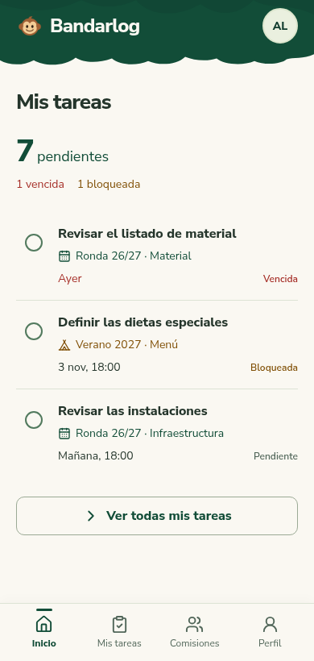
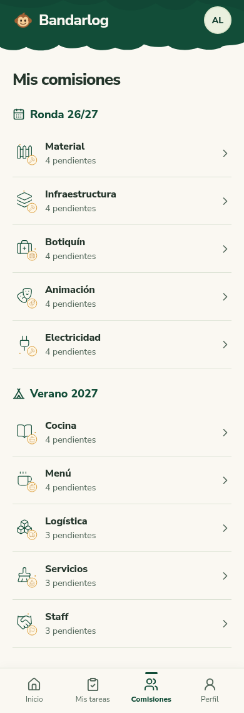
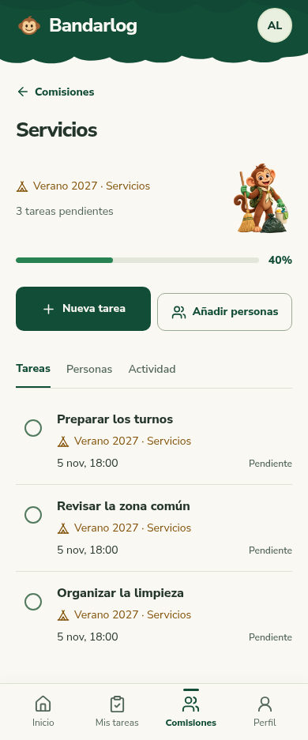
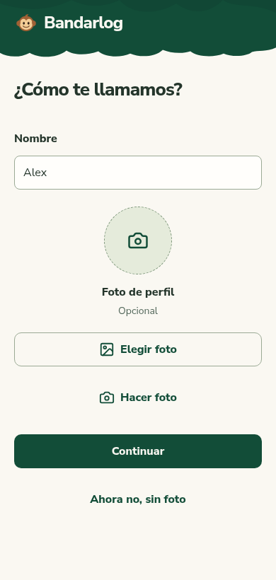

# Forest Experience · propuesta Codex refinada

**Actualización de implementación:** el usuario aprobó la propuesta refinada y ajustó todos los guiños a 2D, incluida la liana. Los recursos 3D de estas láminas quedan sustituidos por esa decisión. Estado actual y comprobaciones: [implementación](implementacion.md).

**Veredicto independiente: `meets direction`.** Ronda 1 completada: quince correcciones resueltas, ninguna parcial ni pendiente material en la propuesta estática revisada. La aprobación visual del usuario sigue pendiente; la aplicación no se ha modificado.

## Pantallas para aprobar

| Inicio | Comisiones |
| --- | --- |
|  |  |

| Comisión | Primer acceso |
| --- | --- |
|  |  |

[Invitación por lista de correos](codex/revision-1/captures/r1-invite-list-390.png) · [Última tarea completada](codex/revision-1/captures/r1-completed-390.png) · [Vista horizontal real](codex/revision-1/captures/r1-landscape-844.png).

## Cambios de la ronda

- Copa de árbol con lóbulos asimétricos y volumen contenido, conservando marca, paleta y altura compacta.
- Iconos originales asociados a cada comisión, listas continuas y contexto legible.
- Navegación inferior visible durante scroll y en horizontal, con espacio para acceder a la última fila.
- Nombre obligatorio, foto opcional, editor con imagen de prueba, cancelación y llegada a Inicio tras omitir foto.
- Código con espera, agotamiento y recuperación; invitación individual/lista y destinos de comisión/proyecto fijos.
- Siete tareas personales completas, secuencia visual 1→0→equipo, variantes de lectura/gestión y cifras reconciliadas con el fixture.

Se corrigió únicamente la propuesta de Codex, como pidió el usuario. Stitch y sus recursos originales permanecen intactos. El checkpoint inicial sigue disponible en `452183a`; esta ronda no redefine el contrato ni mezcla los dos diseños.

## Evidencia y alcance

43 escenas —27 principales y16 variantes—, 251 capturas y187 registros geométricos. Tamaños inspeccionados:320/375/390/430, tablet768, desktop1440 y horizontal844×390. Las capturas completas muestran contenido íntegro; las de viewport y scroll prueban la composición visible por separado.

Las mediciones registran cero desbordamientos horizontales, imágenes rotas, controles menores de44px, navegación fuera de viewport o última fila oculta en los tres desplazamientos comprobados. No se convierten esos resultados en una certificación de toda la accesibilidad ni de dispositivos físicos.

Dataset reconciliado:74 =7propias abiertas +30abiertas de equipo +14de otras comisiones del campamento solo agregadas +23terminadas. Las filas de comisión suman37 en el estado inicial y30 tras terminar las personales; cada pantalla usa la etapa correspondiente. No hay datos reales del grupo.

- [Revisión independiente, matriz F01–F27 y quince correcciones](codex/revision-1/independent-review.md).
- [Informe de construcción y capturas](codex/revision-1/REPORT.md).
- [Mediciones](codex/revision-1/measurements.json), [hallazgos geométricos](codex/revision-1/findings.json), [reconciliación de datos](codex/revision-1/dataset-reconciliation.json).
- [Manifiesto del conjunto de recursos Codex](codex/revision-1/assets-manifest.json).
- [Tablero completo](codex/index.html), estático y sin acciones de aplicación.

El revisor señaló un pequeño desfase óptico entre las dos acciones de F14 a320px; no incumple el contrato, la legibilidad ni el área táctil y no se considera material. Se conserva la evidencia sin abrir otra ronda de microajustes.

## Próximo paso del flujo

El modo elegido es Seguir recomendación. Su siguiente parada es **aprobar la propuesta visual corregida**. Tras esa aprobación se usará el [handoff canónico](handoff.md) para implementar en la rama de desarrollo y entregar un PR revisable; no se necesita volver a decidir fuentes, objetivo ni renderizador.

Pendiente de implementación y prueba real: autenticación por código/Google, renovación de sesión, onboarding persistido, permisos, recorte funcional, animaciones, PWA instalada, accesibilidad asistida y regresiones de la aplicación desktop. La separación de todos los monos del catálogo también pertenece a esa implementación. No se han cambiado variables de Railway, enviado correos ni desplegado.
